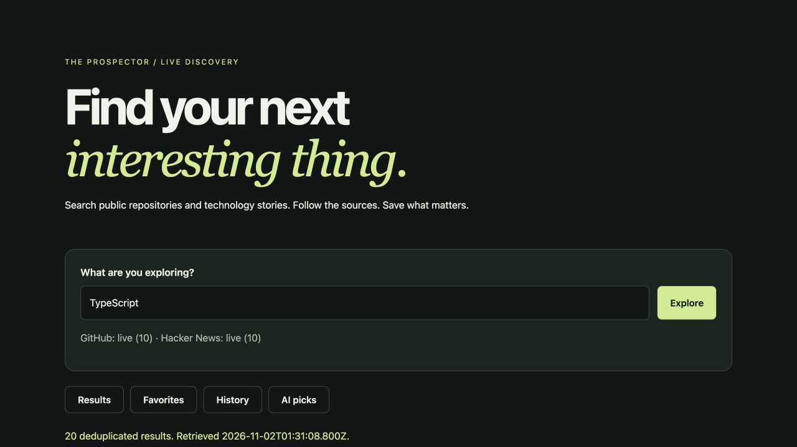

# The Prospector

A co-developed search project with a Node.js and Express demo that combines public GitHub repositories and Hacker News stories in one interface.

**[Open the live demo →](https://spattoor-prospector.onrender.com/)**



## Try it

- Search a topic across GitHub and Hacker News; the UI reports each source's availability.
- Open the original source links and save favorites.
- View saved favorites and search history without an account. Guest collections are saved in this browser only, up to 50 entries; browser storage can be cleared or disabled.

The hosted app is a reviewed demonstration of the larger hackathon project. This deployed path verifies two public search sources. It does not claim five deployed APIs or a working Google Calendar integration.

## Run from a fresh clone

Use Node.js 22.9 or newer:

```bash
git clone --branch portfolio-deployment https://github.com/spattoor/The-Prospector.git
cd The-Prospector/deploy
npm ci --ignore-scripts
npm start
```

Open `http://localhost:3000`. The reviewed entrypoint is `deploy/server.mjs`. It serves only `deploy/public/` and does not run the older root servers or require the absent original Vite client. Guest search, favorites and history require no provider key or database.

## Verify

From the `deploy` directory:

```bash
npm test
```

Eight tests passed after a fresh clone and locked install: password verification, guest behavior, account ownership, logout, origin/input validation, curated campus retrieval, AI evidence validation, and provider failure. Account tests use an in-memory adapter and do not establish real MongoDB persistence.

## Optional features

| Setting | Purpose |
| --- | --- |
| `MONGODB_URI` | Enable server-backed accounts and cross-device collections |
| `GEMINI_API_KEY`, `GEMINI_MODEL` | Enable validated AI selection from returned source IDs |
| `PORT` | Hosting supplies it; local default is 3000 |
| `NODE_ENV=production` | Secure cookies and proxy handling |
| `CAMPUS_ORIGIN` | Exact allowed origin for the separate campus endpoint |

Configure secrets in the host's environment or an ignored `deploy/.env`; do not put them in browser code. AI picks are hidden when the provider is unconfigured. Live AI and real database persistence are not claimed as verified in this public demo.

## Deployment

Render runs branch `portfolio-deployment`, root directory **`deploy`**, build **`npm ci --omit=dev`**, start **`npm start`**, compute **Free**. Source requests have timeouts, caches, input limits and per-source failure reporting. The server does not serve repository files or environment files.

Free Render services can sleep after 15 minutes without requests. The next visit can take about a minute to wake the service; open it before a live presentation. No paid plan or always-on guarantee is included.

[Live demo](https://spattoor-prospector.onrender.com/) · [Reviewed deployment code](https://github.com/spattoor/The-Prospector/tree/portfolio-deployment/deploy)
