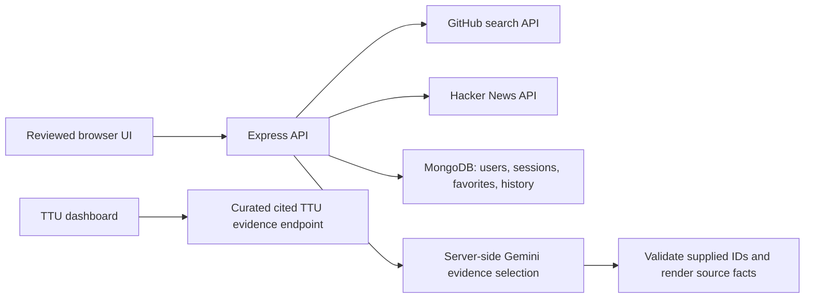

# The Prospector

A Node.js and Express portfolio demo for discovering public repositories and technology stories, saving favorites, and selecting relevant evidence with Gemini.

**Live link:** pending deployment. **Screenshot:** save the deployed app as `docs/screenshot.png`, then embed it here.

## Reviewed deployment path

The reviewed runtime is **`deploy/server.mjs`**, with its own pinned dependencies and lockfile. It serves only `deploy/public/`. It does not execute the older servers, serve the repository root, or require the absent `client/` directory.

- Live GitHub repository search and Hacker News search; visible per-source availability and deduplication. This deployment claims two sources, not five verified APIs.
- Optional username/password accounts, favorites, and search history in MongoDB. Passwords use salted scrypt hashes; sessions use random opaque tokens with hashed storage, expiry and HTTP-only cookies. Ownership is checked server-side.
- Without MongoDB the UI explicitly uses guest-only search; accounts and persistence are unavailable.
- Optional Gemini evidence selection from fresh search results. Runtime validation rejects invented IDs, unexpected fields and inconsistent answers. The displayed facts come from source results. Unavailable AI is visibly labeled.
- A small cited TTU evidence endpoint for the separate student dashboard. It uses curated public sources, not student records. This is evidence selection and lexical retrieval, not embedding/vector search.

The original Gemini TypeScript service was inspected, but its original Vite app cannot build from the current checkout because `client/` is absent. The new deployment is an explicit smaller demo; Google sign-in, Calendar integration, newsletter sending and the old multi-API discovery paths are not claimed as deployed.

## Run

Use Node.js 22:

```bash
cd deploy
npm ci
cp .env.example .env
npm start
```

Open `http://localhost:3000`. Configure fresh credentials in `deploy/.env` for local use. On Render set **Root directory `deploy`**, build command **`npm ci --omit=dev`**, start command **`npm start`**, instance **Free**.

```bash
cd deploy
npm test
```

## Environment

| Variable | Required | Purpose |
|---|---|---|
| `PORT` | No | Hosting supplies it; local default 3000 |
| `NODE_ENV` | Production | `production` enables secure cookies and proxy handling |
| `GEMINI_API_KEY` | AI only | Fresh server-side Gemini key |
| `GEMINI_MODEL` | No | `gemini-3.5-flash-lite`; verify account access |
| `MONGODB_URI` | Persistence only | Fresh Atlas database user/connection string |
| `CAMPUS_ORIGIN` | Campus API only | Exact frontend origin; default `https://spattoor.github.io` |

Never put provider keys into browser code, GitHub, screenshots, or chat. The server limits requests, bounds source/AI input and output, sets timeouts, and caches public searches and successful AI calls. AI caps reset on process restart; they are not provider billing caps. Use a free-only model project and inspect provider quotas.

## Architecture



## Security status and verification limits

The original repository history contains exposed credentials. Current-source cleanup removes tracked env/cookie/state files and literal values identified in the reviewed source. **This does not revoke keys or erase old commits.** Rotate all exposed provider tokens, GitHub tokens and database passwords before claiming remediation; history cleanup is still separate work.

Local checks exercise password verification, guest limitations, account ownership, logout, input/origin restrictions, curated retrieval, AI output validation and provider failure. Database ownership tests use an in-memory adapter; they are not proof of real MongoDB persistence. A separate live source check returned GitHub and Hacker News results. Hosting, live AI in this service, real database storage/restart behavior and the campus browser integration remain to be verified.

## Common failures

| Symptom | Fix |
|---|---|
| Build asks for `client/index.html` | Render root must be `deploy`, not repository root |
| Guest-only mode | Add a fresh `MONGODB_URI`, then restart |
| Startup fails after adding MongoDB | Check Atlas database user, encoded password, network access and URI; server does not silently substitute memory storage |
| AI unavailable | Check fresh server key, model access and free quota; do not label source results as AI |
| Secure cookie absent locally | Use development mode locally; production requires HTTPS |
| Campus CORS failure | Set the exact deployed frontend origin, including scheme |

Render’s Free service can sleep after inactivity. Open it before a live demonstration; no always-on availability or latency claim is made.
